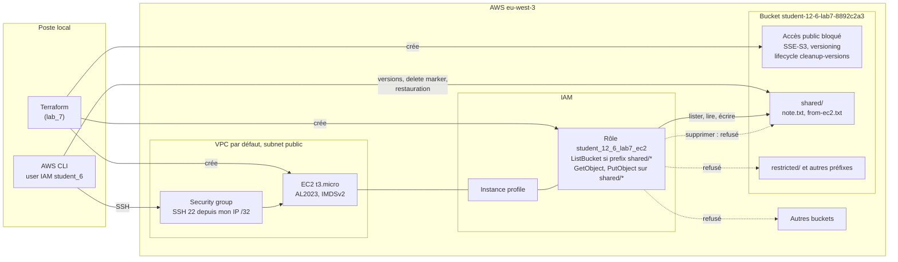

# Lab 7 : S3 (versioning, chiffrement, lifecycle) et accès EC2 par rôle IAM

Binôme `student_12_6`, région `eu-west-3`.

| Élément | Valeur |
|---|---|
| Bucket | `student-12-6-lab7-8892c2a3` |
| Rôle / instance profile EC2 | `student_12_6_lab7_ec2` |
| Instance | `t3.micro`, Amazon Linux 2023, tag `student_12_6_lab7` |
| State Terraform | `terraform-state-w9e85` / `global/s3/student_12_6/lab7.tfstate` |

## Schéma



Les flèches pleines sont les accès autorisés et vérifiés, les flèches en pointillés les accès
refusés (`AccessDenied`) et vérifiés.

## Fichiers

| Fichier | Contenu |
|---|---|
| `main.tf` | Providers, backend S3, `local.prefix` |
| `s3.tf` | Student X : bucket, blocage de l'accès public, SSE-S3, versioning, lifecycle |
| `ec2.tf` | Student Y : rôle IAM, instance profile, security group SSH, key pair, instance |
| `variables.tf` | Région, identifiants, numéros des étudiants, `ssh_cidr`, `public_key_path` |
| `outputs.tf` | `bucket_name`, `bucket_arn` (à transmettre au student Y) |

## Déploiement

`terraform.tfvars` (non versionné) contient `region`, `access_key`, `secret_key`.
`ssh_cidr` n'a volontairement pas de valeur par défaut, pour ne jamais écrire une IP dans le repo :

```bash
cd lab_7
terraform init
terraform apply -var "ssh_cidr=$(curl -s https://checkip.amazonaws.com)/32"
terraform output ssh_command
```

Nettoyage : `terraform destroy -var "ssh_cidr=0.0.0.0/32"`. Le bucket a `force_destroy = true`,
sinon la destruction échoue tant qu'il reste des versions.

## Student X : le bucket (`s3.tf`)

- **Nom** : préfixe du binôme + suffixe aléatoire (`random_id`), les noms de bucket étant uniques au niveau mondial.
- **Accès public** : les quatre réglages de `aws_s3_bucket_public_access_block` sont à `true`, et `BucketOwnerEnforced` désactive les ACL.
- **Chiffrement** : SSE-S3 (`AES256`) par défaut sur tous les objets.
- **Versioning** : `Enabled`.
- **Lifecycle** (règle `cleanup-versions`, tout le bucket) :
  - les versions non courantes expirent après 7 jours ;
  - les delete markers qui n'ont plus aucune version derrière eux sont supprimés ;
  - les uploads multipart incomplets sont abandonnés après 1 jour.

  Ces règles s'exécutent de façon asynchrone : inutile d'attendre l'expiration pendant le lab.

### Exercice de versioning (AWS CLI)

```bash
B=student-12-6-lab7-8892c2a3; K=shared/note.txt

# Deux uploads sur la même clé
echo "version 1 - original" > note.txt
aws s3api put-object --bucket $B --key $K --body note.txt   # renvoie le VersionId V1
echo "version 2 - modified" > note.txt
aws s3api put-object --bucket $B --key $K --body note.txt   # renvoie le VersionId V2

# a) Lister les versions et récupérer l'originale
aws s3api list-object-versions --bucket $B --prefix $K
aws s3api get-object --bucket $B --key $K --version-id <V1> v1.txt

# b) Supprimer sans version ID, puis repérer le delete marker
aws s3api delete-object --bucket $B --key $K
aws s3api list-object-versions --bucket $B --prefix $K --query DeleteMarkers

# c) Récupérer l'objet en supprimant le delete marker
aws s3api delete-object --bucket $B --key $K --version-id <ID_DU_DELETE_MARKER>

# d) Restaurer une ancienne version comme version courante
#    (le versionId n'apparaît que dans la source, pas dans la clé de destination)
aws s3api copy-object --bucket $B --key $K --copy-source "$B/$K?versionId=<V1>"
```

Résultats obtenus :

| Étape | Résultat |
|---|---|
| a | Deux versions listées, V2 en `IsLatest`. Le téléchargement de V1 rend `version 1 - original`. |
| b | La suppression renvoie `"DeleteMarker": true`. Le marker devient la dernière version, `aws s3 ls` ne montre plus rien, V1 et V2 existent toujours. |
| c | La suppression du marker par son version ID renvoie `"DeleteMarker": true`. La lecture passe de 404 à `version 1 - original`, et `DeleteMarkers` est vide. |
| d | La copie crée une nouvelle version courante dont le contenu est `version 1 - original`. |

Note : au premier essai, l'étape c échouait en `AccessDenied` car l'utilisateur IAM `student_6`
n'avait pas `s3:DeleteObjectVersion`. Une fois la permission ajoutée, l'étape a été rejouée
(nouvelle suppression, nouveau marker, suppression du marker) et le marker du premier essai a
aussi été supprimé. Le rôle EC2, lui, n'a toujours aucun droit de suppression.

## Student Y : EC2 et IAM (`ec2.tf`)

Aucune instance du binôme n'existait, une `t3.micro` est donc créée dans le VPC par défaut
(subnet public), avec IMDSv2 obligatoire.

### Policy du rôle

Policy inline `s3_shared_prefix`, limitée aux ARN fournis par le student X :

| Sid | Actions | Ressource | Condition |
|---|---|---|---|
| `ListSharedPrefix` | `s3:ListBucket` | ARN du bucket | `s3:prefix` like `shared/*` |
| `ReadWriteShared` | `s3:GetObject`, `s3:PutObject` | `<ARN du bucket>/shared/*` | aucune |

Rien d'autre : pas de `s3:DeleteObject`, pas d'autre bucket, pas d'autre préfixe, aucune policy
managée attachée (donc pas de `AmazonS3FullAccess`).

### Connexion

Session Manager n'est pas utilisable ici : nos utilisateurs IAM n'ont pas `ssm:SendCommand`.
L'accès se fait en SSH restreint : port 22 ouvert uniquement pour `ssh_cidr` (notre IP en /32),
avec la clé publique `~/.ssh/id_ed25519.pub`.

```bash
$(terraform output -raw ssh_command)
```

### Tests sur l'instance

Aucune clé statique n'est configurée : `aws configure list` montre des identifiants de type `iam-role`.

```bash
B=student-12-6-lab7-8892c2a3

aws configure list
aws sts get-caller-identity                                   # a
aws s3 ls s3://$B/shared/                                     # b
aws s3 cp s3://$B/shared/note.txt /tmp/note.txt               # c
echo "hello from the EC2 role" > /tmp/from-ec2.txt
aws s3 cp /tmp/from-ec2.txt s3://$B/shared/from-ec2.txt       # d
aws s3 cp /tmp/from-ec2.txt s3://$B/restricted/from-ec2.txt   # e : refusé
aws s3 rm s3://$B/shared/note.txt                             # f : refusé
```

| Étape | Résultat |
|---|---|
| a | `assumed-role/student_12_6_lab7_ec2/<instance-id>` |
| b | Liste `note.txt` |
| c | Fichier téléchargé, contenu `version 1 - original` |
| d | `from-ec2.txt` envoyé sous `shared/` |
| e | `AccessDenied` sur `s3:PutObject` |
| f | `AccessDenied` sur `s3:DeleteObject` |
| En plus | `aws s3 ls` sur la racine du bucket, sur `restricted/`, sur la liste des buckets et sur `terraform-state-w9e85` : tous `AccessDenied` |

## Validation commune

```bash
B=student-12-6-lab7-8892c2a3
aws s3api get-public-access-block --bucket $B
curl -s -o /dev/null -w "%{http_code}\n" https://$B.s3.eu-west-3.amazonaws.com/shared/note.txt
aws s3api get-bucket-encryption --bucket $B
aws s3api head-object --bucket $B --key shared/note.txt --query ServerSideEncryption
aws s3api get-bucket-versioning --bucket $B
aws s3api get-bucket-lifecycle-configuration --bucket $B
```

| Vérification | Résultat |
|---|---|
| Bucket non public | Les quatre réglages du public access block à `true`, aucune bucket policy, GET anonyme en 403 |
| Chiffrement SSE-S3 | Défaut du bucket `AES256`, `note.txt` et `from-ec2.txt` en `AES256` |
| Versioning | `Enabled` |
| Student Y limité au préfixe | Voir les tests e, f et les refus supplémentaires ci-dessus |
| Lifecycle | Règle `cleanup-versions` active, voir la section Student X |

### Supprimer un objet, delete marker, suppression définitive d'une version

- **Supprimer un objet sans version ID** sur un bucket versionné ne supprime rien. S3 ajoute un
  delete marker comme dernière version : les lectures normales renvoient 404, les anciennes
  versions restent intactes.
- **Le delete marker** est ce marqueur. Le supprimer lui-même, par son version ID, rend la
  version précédente de nouveau courante.
- **Supprimer avec un version ID** efface définitivement cette version précise, sans retour
  possible. L'action demande `s3:DeleteObjectVersion`.

### Pourquoi restreindre le rôle EC2 ne restreint pas les étudiants

La policy du rôle est une policy d'identité attachée au rôle. Elle ne s'applique qu'aux requêtes
signées avec les identifiants temporaires du rôle, c'est-à-dire à l'AWS CLI lancée sur
l'instance. `student_6` et `student_12` sont des principals distincts, évalués avec leurs propres
policies utilisateur : depuis un poste local, ils accèdent au bucket indépendamment du rôle.
Pour restreindre tout le monde, il faudrait une bucket policy avec des `Deny` explicites, qui
s'applique à tous les principals.
